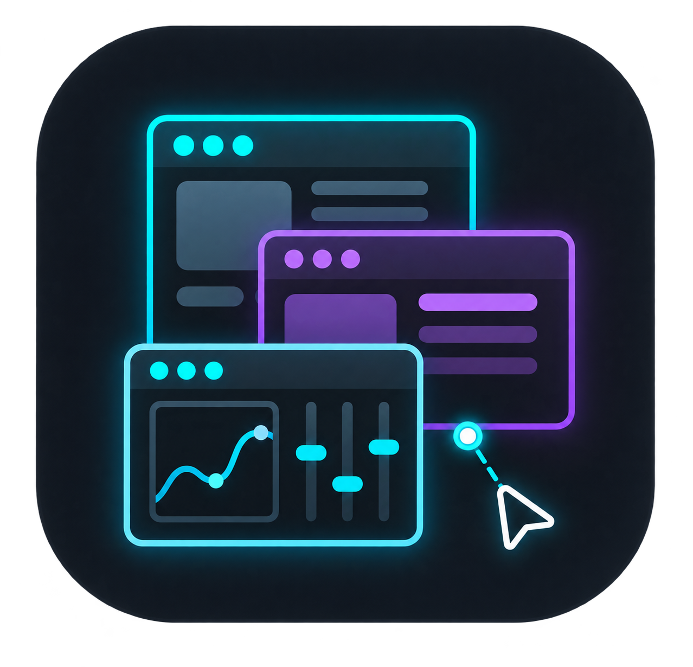

<!--suppress HtmlDeprecatedAttribute, HttpUrlsUsage -->

<div align="center">
  <p>
    
  </p>

  <p>Crea interfaces de usuario flotantes con Dear ImGui</p>

  <p>
    <a href="https://github.com/SuperMonster003/AutoJs6-Plugin-ImGui/releases"></a>
    <a href="https://github.com/SuperMonster003/AutoJs6-Plugin-ImGui/issues"></a>
    <a href="https://github.com/ocornut/imgui"></a>
    <br>
    <a href="https://developer.android.com/studio/archive"></a>
    <a href="https://www.jetbrains.com/idea/download/other.html"></a>
    <a href="https://github.com/SuperMonster003/AutoJs6-Plugin-ImGui/blob/master/LICENSE"></a>
  </p>
</div>

******

### Idiomas (Languages)

******

El archivo README.md actual admite los siguientes idiomas:

- [简体中文 [zh-Hans]](https://github.com/SuperMonster003/AutoJs6-Plugin-ImGui/blob/master/.readme/README-zh-Hans.md)
- [繁體中文 (香港) [zh-Hant-HK]](https://github.com/SuperMonster003/AutoJs6-Plugin-ImGui/blob/master/.readme/README-zh-Hant-HK.md)
- [繁體中文 (台灣) [zh-Hant-TW]](https://github.com/SuperMonster003/AutoJs6-Plugin-ImGui/blob/master/.readme/README-zh-Hant-TW.md)
- [English [en]](https://github.com/SuperMonster003/AutoJs6-Plugin-ImGui/blob/master/.readme/README-en.md)
- [Français [fr]](https://github.com/SuperMonster003/AutoJs6-Plugin-ImGui/blob/master/.readme/README-fr.md)
- Español [es] # actual
- [日本語 [ja]](https://github.com/SuperMonster003/AutoJs6-Plugin-ImGui/blob/master/.readme/README-ja.md)
- [한국어 [ko]](https://github.com/SuperMonster003/AutoJs6-Plugin-ImGui/blob/master/.readme/README-ko.md)
- [Русский [ru]](https://github.com/SuperMonster003/AutoJs6-Plugin-ImGui/blob/master/.readme/README-ru.md)
- [العربية [ar]](https://github.com/SuperMonster003/AutoJs6-Plugin-ImGui/blob/master/.readme/README-ar.md)

******

### Introducción

******

El plugin ImGui lleva la biblioteca de interfaz gráfica de modo inmediato [Dear ImGui](https://github.com/ocornut/imgui) a AutoJs6 y renderiza los controles con OpenGL ES dentro de una ventana flotante transparente. Encaja de forma natural en interfaces flotantes ligeras como paneles de depuración, ajustadores de parámetros y HUD de tiempo de ejecución, y reúne la creación de ventanas, la planificación de fotogramas, la entrada táctil y la limpieza de recursos nativos en una API compacta.

Una vez habilitado el plugin en el Centro de plugins, los scripts usan directamente el objeto global `imgui` (registrado por AutoJs6, que carga el plugin en la primera llamada a uno de sus miembros); no se necesita `plugins.load`. Requiere AutoJs6 6.8.0 o posterior. Cuando el plugin es más reciente que AutoJs6, los miembros que AutoJs6 aún no registra aparecen en `imgui` solo después de cargar el plugin (al usar por primera vez cualquier miembro de `imgui`); el argumento `ui` de los callbacks de renderizado siempre está completo.

******

### Funciones

******

- Sesiones adaptables superpuestas y Activity de pantalla completa con paso táctil automático, contraer/expandir, botones flotantes independientes, opacidad/seguridad, diseño persistente y eventos de ciclo de vida.
- `launchPrivileged` ofrece un modo SurfaceFlinger de producción explícito mediante Shizuku/root gestionado por AutoJs6; Binder autenticado entrega la Surface privilegiada al renderizador completo existente y `/dev/input` aporta entrada de puntero observada.
- AutoJs6 registra el plugin directamente como objeto global `imgui`, por lo que no hace falta ningún paso de carga tras habilitarlo, igual que en los plugins oficiales pinyin / mediainfo.
- Ventanas flotantes transparentes con tamaño, posición, frecuencia de fotogramas y fuente configurables; arrastre un área vacía para mover la ventana, use desplazamiento inercial con dos dedos y mantenga pulsado con uno para hacer clic derecho. Tras unos segundos sin entrada la frecuencia de fotogramas baja para ahorrar batería, y el dibujo se pausa con la pantalla apagada.
- La familia `inputText` está completamente conectada al IME del sistema, incluido el texto en composición, la visibilidad automática del teclado virtual y las teclas de edición habituales.
- Ventanas, pestañas, nodos de árbol, tablas, ventanas emergentes, menús, tooltips y más de 60 controles de modo inmediato, incluido un interruptor `toggle` de estilo móvil.
- Sistema visual y tipográfico con 11 `Themes`, estilos por lotes, apariencias redondeadas/con borde/sombra, pila multifuente, respaldo CJK y subconjunto Material Icons.
- Las texturas administradas aceptan rutas de archivo, bytes codificados, `Bitmap` de Android y objetos `Image` de AutoJs6; `image` / `imageButton` y tres capas DrawList cubren la visualización de imágenes y el dibujo personalizado.
- `session.capture()` devuelve la ventana como `Image` de AutoJs6; con `systemCjkFont: true` el sistema dibuja los caracteres CJK que faltan en la fuente integrada, con `pinchZoom: true` dos dedos cambian la escala de la fuente, y las ventanas siguen los cambios de densidad de pantalla y de tamaño de fuente del sistema.
- Las referencias ligeras `imgui.ref(value)` / `{value: x}` funcionan con todos los controles con estado y los helpers de arrays Java existentes siguen siendo totalmente compatibles.
- Los componentes de sesión `logWindow`, `toast` apilados, diálogos Promise, `statsOverlay` con umbrales y `dataTable` CRUD seleccionable ofrecen interfaces de depuración listas para usar.
- Las API comunes y las enumeraciones de constantes tienen alias en PascalCase (p. ej., `ui.Button`) que conservan el estilo de argumentos del plugin; la lista de alias y las diferencias con las firmas C++ originales están en [ALIASES.md](https://github.com/SuperMonster003/AutoJs6-Plugin-ImGui/blob/master/docs/ALIASES.md).
- El soporte de ingeniería incluye declaraciones TypeScript completas, nueve ejemplos ejecutables, pruebas Android de renderizado, cola de entrada sin bloqueo, actualización upstream verificable y automatización CI de versiones.
- Metadatos del plugin, instrucciones de uso, README y CHANGELOG localizados en diez idiomas.

******

### Instalación

******

- Descargue desde [Releases](https://github.com/SuperMonster003/AutoJs6-Plugin-ImGui/releases) el APK que corresponda a la arquitectura de su dispositivo; si tiene dudas, elija el paquete `universal`.
- Instale el APK, abra AutoJs6 y confirme en la página de gestión de plugins que este plugin está reconocido y habilitado.
- Llame directamente a `imgui.createWindow(...)` en el script; conceda a AutoJs6 el permiso de superposición (ventana flotante) en el primer uso.
- Antes de `launchPrivileged`, configure y autorice Root o Shizuku normalmente en AutoJs6. El plugin reutiliza ese estado del host y el modo privilegiado no necesita permiso de superposición.

Requisito del host: AutoJs6 con versionCode 5935 o posterior. El plugin incluye binarios `arm64-v8a` / `armeabi-v7a` / `x86_64` / `x86` y requiere Android 7.0 (API 24) o posterior además de una GPU/controlador compatible con OpenGL ES 3.0.

******

### Inicio rápido

******

Con el plugin instalado y habilitado, cree referencias mutables y abra una ventana flotante:

```js
var enabled = imgui.ref(true);
var volume = imgui.ref(0.5);
var themeColor = imgui.ref([0.25, 0.55, 0.90]);

imgui.createWindow(function (ui, overlay) {
    ui.setNextWindowPos(0, 0, ui.Cond.Always);
    ui.setNextWindowSize(ui.dp(overlay.width), ui.dp(overlay.height), ui.Cond.Always);
    ui.withWindow(
        "ImGui Panel",
        null,
        ui.WindowFlags.NoMove | ui.WindowFlags.NoResize | ui.WindowFlags.NoCollapse,
        function () {
            ui.text("Dear ImGui " + ui.version());
            ui.toggle("Enabled", enabled);
            ui.sliderFloat("Volume", volume, 0, 1, "%.2f");
            ui.colorEdit3("Theme", themeColor);
            if (ui.button("Close", 120, 0)) {
                overlay.close();
            }
        }
    );
}, {
    width: 360,
    height: 240,
    fontSize: 16,
    theme: imgui.Themes.ModernDark,
    appearance: imgui.Appearance.Rounded,
    fps: 60
});
```

Los controles mutables aceptan referencias ligeras creadas con `imgui.ref(value)` u objetos `{ value: ... }`; los ayudantes anteriores `imgui.bool` / `imgui.int` / `imgui.float` / `imgui.string` / `imgui.floats` siguen siendo compatibles. Al enfocar `inputText` se abre automáticamente el IME del sistema con composición; pase `ime: false` para desactivarlo. Los tamaños y posiciones de la ventana están en dp: las opciones `width`, `height`, `x` e `y`, los campos de la sesión y los datos de los eventos; `fontSize` también está en dp. Las coordenadas dentro de un fotograma están en px; conviértalas con `ui.dp()` / `ui.px()`. Las devoluciones de llamada de eventos y botones se ejecutan en el hilo del script (consulte [THREADING.md](https://github.com/SuperMonster003/AutoJs6-Plugin-ImGui/blob/master/docs/THREADING.md)), y [MIGRATION-1.12.md](https://github.com/SuperMonster003/AutoJs6-Plugin-ImGui/blob/master/docs/MIGRATION-1.12.md) enumera los cambios respecto a versiones anteriores. Arrastre un área vacía para mover la ventana (`movable: false` la fija); el deslizamiento vertical con dos dedos tiene inercia configurable (`fling`, `flingFriction`, `flingMinVelocity`, `flingMaxVelocity`) y una pulsación larga con un dedo emite un clic derecho (`longPressAsRightClick`, `longPressDuration`, `longPressSlop`). Cuando la fuente del sistema no cubra los caracteres necesarios, apunte `fontPath` a un archivo de fuente TTF u OTF.

Temas y fuentes: `setTheme` acepta los 11 valores de `Themes` y `setStyleProperties` actualiza varios `StyleVar`; `createWindow` también admite `theme`, `appearance`, `style` y `shadow`. El arreglo `fonts` precarga fuentes de assets (`asset://...`) o archivos para `pushFont` / `withFont`. El respaldo CJK y los iconos se fusionan automáticamente; use `Icons` / `icon(name)` para obtener glifos de iconos.

Texturas y dibujo personalizado: llame a `createTexture` solo cuando la sesión de ventana esté lista (normalmente la primera vez dentro de su callback de renderizado). El objeto devuelto expone `width`, `height`, `update(source)` (reemplaza los píxeles y conserva el identificador; `width` / `height` siguen el nuevo tamaño) y `dispose()` / `close()` idempotentes; las texturas restantes se liberan automáticamente al cerrar la sesión. `image` / `imageButton` muestran texturas, mientras que `getWindowDrawList`, `getForegroundDrawList` y `getBackgroundDrawList` ofrecen primitivas habituales. Las coordenadas DrawList son píxeles del Surface. Se pueden pasar directamente valores `Image` de AutoJs6 obtenidos mediante `images.read(...)` o capturas de pantalla, así como un `ArrayBuffer` o un arreglo tipado con datos PNG o JPEG.

Sesiones de ventana: las superposiciones usan `TouchMode.Auto` por defecto, manteniendo interactivas las raíces ImGui y pasando las zonas vacías del Surface a la aplicación inferior; elija `Touchable` o `Passthrough` para una política fija. Una sesión puede cambiar opacidad/seguridad/modo táctil, reducirse a una miniburbuja de pocos FPS, crear `addButtonEx` arrastrables, seguir contenido `AlwaysAutoResize`, guardar el diseño con `iniPath` y emitir eventos mediante `on` / `once` / `off` o callbacks de opciones. `imgui.launch(...)` crea un Surface de pantalla completa en la Activity AutoJs6 actualmente reanudada y `launchFloaty(...)` selecciona explícitamente una superposición. Cada motor de scripts tiene una sesión de renderizado nativa, pero su callback puede crear todas las raíces ImGui `begin` / `withWindow` necesarias; una sesión nueva cierra la anterior. Una excepción del callback de renderizado o de un callback de evento se imprime con su pila mediante `console.error` (una sola vez para una racha del mismo error) y se emite como evento `error` (`error` / `phase` / `frame`); sin un listener de `error`, un error de renderizado cierra la sesión (`closeReason` es `render-error`), y con uno se omite el resto del fotograma y el renderizado continúa. La opción `debug: true` informa con `console.warn` y logcat de errores de uso como un `begin` sin `end`, y muestra las ventanas Metrics y Debug Log. Los métodos globales como `setTouchable` / `setGlobalAlpha` / `getComponent` actúan sobre la sesión actual y lanzan `imgui.<name>: no active session` si no hay ninguna activa. En una sesión de `imgui.launch`, la tecla Atrás cierra la sesión (`closeReason` es `back`) salvo que un oyente de `back` llame a `event.preventDefault()`; si el teclado en pantalla está visible, la tecla Atrás primero lo oculta. Las ventanas superpuestas reciben la tecla Atrás solo mientras su entrada de texto tiene el foco, y entonces solo ocultan el teclado. Con `debug: true`, una devolución de llamada de dibujo de más de 250 ms también muestra un `console.warn` que sugiere `threads.start` (como mucho una vez cada 10 segundos).

Los componentes de alto nivel se adjuntan a la sesión activa y se dibujan después del callback del usuario: `logWindow` ofrece niveles con color, limpieza, exportación y desplazamiento automático; `toast` muestra avisos temporizados; `alert` / `confirm` / `singleChoice` / `multiChoice` resuelven Promises; `statsOverlay` grafica el tiempo de cuadro y muestra el tiempo de trabajo de cada cuadro; y `dataTable` ofrece selección y CRUD. Los diez ejemplos (`widget-overview`, `parameter-panel`, `log-hud`, `data-table-demo`, `theme-gallery`, `error-handling`, `background-task`, `large-list`, `texture-refresh` y `multi-window`) se descubren con `listExamples` / `getExampleSource` y se ejecutan con `runExample`. AutoJs6 6.8 aún no consume los metadatos genéricos de ejemplos en su centro de plugins; hasta que el host lo admita, ejecute directamente la llamada siguiente:

```js
imgui.runExample("widget-overview");
```

******

### Resumen de la API

******

Las API comunes también tienen alias en PascalCase (p. ej., `ui.Button` equivale a `ui.button`). Los alias mantienen el estilo de argumentos del plugin (valores mutables con `imgui.ref`, etc.) y no corresponden uno a uno con las firmas C++ originales; la lista y las diferencias están en [ALIASES.md](https://github.com/SuperMonster003/AutoJs6-Plugin-ImGui/blob/master/docs/ALIASES.md). Los métodos en lower camel case reflejan las operaciones de Dear ImGui del mismo nombre y se agrupan así:

- Ejecución de sesión: `launch` / `launchFloaty` / `launchPrivileged` / `TouchMode` / `WindowMode`, `setTouchable` / `setMoreTouch` / `setGlobalAlpha` / `setSecure`, `collapseWindow` / `expandWindow`, `addButtonEx`, conversión de unidades `density` / `dp` / `px`, `on` / `once` / `off` junto con sus formas por sesión, el evento de sesión `error` que informa de los errores de los callbacks, la opción `debug` que activa el modo de depuración y el ahorro de energía con `idleFps` / `idleDelay`, `setFps` / `setIdleFps` / `getFps` y los eventos `idle` / `active`.
- Detección del backend: `getBackendCapabilities` / `BackendStatus` informa de la disponibilidad y preparación para producción de las ventanas, el toque dividido, el proceso privilegiado, la entrada directa, Docking y Multi-Viewport, sin elevar privilegios.
- Sesión y ventanas: `createWindow` / `closeWindow` / `withWindow` / `withChild` / `setNextWindowPos` / `setNextWindowSize` / `setNextWindowBgAlpha` / `setNextWindowFocus` / `setNextWindowCollapsed`, además de consultas de estado de ventana como `isWindowHovered`.
- Texto y controles: `text` / `textColored` / `textWrapped` / `separatorText` / `bulletText` / `labelText` / `button` / `arrowButton` / `invisibleButton` / `checkbox` / `toggle` / `radioButton` / `sliderFloat` / `sliderInt` / `vSliderFloat` / `dragFloat` / `dragInt` / `inputText` / `inputInt` / `inputFloat` / `inputTextMultiline` / `colorEdit3` / `colorEdit4` / `colorPicker4` / `colorButton` / `progressBar` / `plotLines` / `plotHistogram`, entre otros. Controles de 2 a 4 valores: `dragFloat2/3/4` / `dragInt2/3/4` / `sliderFloat2/3/4` / `sliderInt2/3/4` / `inputFloat2/3/4` / `inputInt2/3/4` / `dragFloatRange2` / `dragIntRange2` / `sliderAngle`.
- Contenedores y navegación: `withTabBar` / `withTabItem` / `withTreeNode` / `treeNodeEx` / `collapsingHeader` / la familia de tablas `withTable` / `withListBox` / `withCombo` / `selectable`, además de `listClipper` para listas largas. Ordenación de tablas: `tableGetSortSpecs` / `SortDirection` y `dataTable` con `sortable: true`. Selección múltiple: `beginMultiSelect` / `endMultiSelect` / `setNextItemSelectionUserData` / `isItemToggledSelection` con `MultiSelectFlags`, y `selectionStorage` para guardar la selección.
- Ventanas emergentes y menús: `openPopup` / `withPopup` / `withPopupModal` / `beginPopupContextItem` / `beginPopupContextWindow` / `withContextItem` / `withContextWindow` / `closeCurrentPopup` / `withMenuBar` / `withMenu` / `menuItem` / `setTooltip` / `setItemTooltip` / `withItemTooltip`.
- Estilo y diseño: `styleColorsDark` / `styleColorsLight` / `styleColorsClassic` / `pushStyleColor` / `pushStyleVar` / `setWindowFontScale` / `withGroup` / `withDisabled` / `withId` / `indent` / `sameLine` / `separator` / `spacing`, además de las familias de cursor y desplazamiento.
- Texturas y dibujo: `createTexture` / `texture.update` / `destroyTexture` / `image` / `imageButton` / `colorU32`, además de `getWindowDrawList` / `getForegroundDrawList` / `getBackgroundDrawList` con primitivas de línea, rectángulo, círculo, triángulo, texto, polilínea, Bézier e imagen. Dibujo de trazados: `pathLineTo` / `pathArcTo` / `pathArcToFast` / `pathBezierCubicCurveTo` / `pathBezierQuadraticCurveTo` / `pathRect` / `pathStroke` / `pathFillConvex` / `pathFillConcave`; `pushClipRect` / `popClipRect` en listas de dibujo y ventanas; más formas: `addEllipse` / `addNgon` / `addQuad` / `addBezierQuadratic` / `addRectFilledMultiColor` / `addConvexPolyFilled` / `addConcavePolyFilled` / `addImageQuad` / `addImageRounded`.
- Consultas y entrada: consultas de estado como `isItemClicked` / `isItemHovered` / `isItemActive` / `isItemEdited` / `isMouseDown` / `getMousePos` / `calcTextSize` / `framerate`, enfoque activo con `setKeyboardFocusHere` y primitivas `addInputCharacters` / `sendKey` / `addMouseWheel` / `wantTextInput`. Todos los valores de `InputTextFlags` expuestos se pasan a Dear ImGui; se omiten los que dependen de callbacks y `WordWrap` solo se aplica a la entrada multilínea. Consultas de teclas y atajos: `isKeyDown` / `isKeyPressed` / `isKeyReleased` / `getKeyPressedAmount` / `getKeyName` / `isKeyChordPressed` / `shortcut` / `setNextItemShortcut`, con combinaciones como `ui.Mod.Ctrl | ui.Key.S`. Portapapeles: `getClipboardText` / `setClipboardText`. Inyección de puntero para pruebas automáticas de la interfaz: `addMousePosEvent` / `addMouseButtonEvent` (píxeles del fotograma, como `getMousePos`).
- Arrastrar y soltar: `withDragDropSource` / `withDragDropTarget`, `beginDragDropSource` / `setDragDropPayload` / `endDragDropSource` / `beginDragDropTarget` / `acceptDragDropPayload` / `endDragDropTarget` / `getDragDropPayload`, con `DragDropFlags`; la carga es una cadena, un número o cualquier objeto serializable a JSON.
- Herramientas de depuración: `showMetricsWindow` / `showDebugLogWindow` / `showIdStackToolWindow` / `showStyleEditor` / `showAboutWindow` / `showUserGuide` muestran las ventanas de herramientas integradas de Dear ImGui; cada una acepta una referencia booleana mutable opcional que el botón de cierre pone a false.
- Componentes de alto nivel y ejemplos: `logWindow` / `toast` / `alert` / `confirm` / `singleChoice` / `multiChoice` / `statsOverlay` / `dataTable`, además de `listExamples` / `getExampleSource` / `runExample`; cada sesión ofrece las mismas fábricas.
- Referencias mutables: `imgui.ref` ligero (o un objeto `{value: x}`), además de los helpers compatibles de arrays Java `imgui.bool` / `imgui.int` / `imgui.float` / `imgui.string` / `imgui.floats` / `imgui.ints` / `imgui.strings`.
- Constantes: `BackendStatus` / `Cond` / `WindowFlags` / `ChildFlags` / `InputTextFlags` / `SliderFlags` / `TreeNodeFlags` / `SelectableFlags` / `TabBarFlags` / `TabItemFlags` / `ComboFlags` / `PopupFlags` / `HoveredFlags` / `FocusedFlags` / `ColorEditFlags` / `TableFlags` / `TableColumnFlags` / `TableRowFlags` / `TableBgTarget` / `SortDirection` / `Col` / `StyleVar` / `Themes` / `Appearance` / `Fonts` / `Icons` / `Dir` / `Key` / `Mod` / `InputFlags` / `DragDropFlags` / `MultiSelectFlags` / `MouseButton` / `ButtonFlags` / `TextureFlags` / `DrawListLayer` / `DrawFlags` / `LogLevel` / `ToastPosition` / `Limits`, que coinciden con las enumeraciones de Dear ImGui o tablas del plugin del mismo nombre.

******

### Limitaciones conocidas

******

- Solo puede existir una sesión de ImGui, y por tanto una Surface, a la vez: una nueva sesión superpuesta o Activity cierra la anterior, y una sesión creada por otro script también la reemplaza. "Varias ventanas" significa varias ventanas raíz de ImGui dentro de esa sesión, no varias ventanas flotantes; consulte `docs/MULTI-WINDOW.md`.
- `imgui.launch` requiere una Activity AutoJs6 actualmente en estado resumed; use `launchFloaty` si el script debe seguir renderizando sin una Activity anfitriona en primer plano.
- El modo privilegiado es fijo a pantalla completa y solo admite puntero: los campos de texto usan un cuadro de entrada temporal de AutoJs6 que requiere el permiso de superposición y solo añade texto en el cursor, y no incluye teclas, alfa/seguridad de capa, reducción, botones Android auxiliares ni reconstrucción dinámica al rotar. La entrada directa no usa `EVIOCGRAB` y las políticas OEM SurfaceControl/SELinux aún pueden impedir el inicio; el sondeo no ejecuta `su` ni solicita Shizuku.

******

### Historial de versiones

******

#### v1.18.1

###### 2026/11/02

* `Corrección` session.on: un oyente de ready añadido después de que createWindow volviera nunca se ejecutaba, porque la ventana suele estar lista antes. Ahora recibe el evento una vez
* `Corrección` session.once: el oyente no recibía la sesión como segundo argumento. Ahora recibe (event, session), igual que con session.on

#### v1.18.0

###### 2026/11/01

* `Función` setNextWindowFocus() y setNextWindowCollapsed(collapsed, condition) permiten a un script enfocar o plegar una ventana de la sesión, para el siguiente begin o withWindow. El ejemplo multi-window tiene un botón para cada una
* `Corrección` dataTable: la función render de una columna estaba documentada pero nunca se llamaba. Ahora dibuja las celdas de esa columna
* `Corrección` launchPrivileged: en Android 12 y posteriores, los toques en el cuadro de texto temporal y el teclado no llegaban, y un toque fuera no cerraba el cuadro. Ahora la capa se oculta mientras el cuadro está abierto
* `Mejora` imgui.d.ts describe la API con precisión: cada miembro tiene un comentario con sus unidades y su hilo, alert / confirm / singleChoice / multiChoice tienen firmas reales, cada evento de sesión tiene sus propios campos, y un nombre de opción mal escrito es un error en TypeScript. Se quitaron las opciones title y background de toast, que nunca hicieron nada. Todos los ejemplos incluidos pasan tsc --strict

#### v1.17.0

###### 2026/11/01

* `Función` Listas de selección múltiple: beginMultiSelect / endMultiSelect / setNextItemSelectionUserData / isItemToggledSelection seleccionan varias filas con un toque, Ctrl+toque, Shift+toque, Ctrl+A y Escape (MultiSelectFlags define las opciones). imgui.selectionStorage() guarda las filas seleccionadas por usted. Funciona con listClipper: un rango con Shift puede abarcar 100000 filas, incluso filas que nunca se dibujaron. Un teléfono no tiene teclas Ctrl ni Shift, por eso el ejemplo large-list muestra dos casillas que las mantienen pulsadas; docs/LIMITS.md explica el resto.
* `Función` Nuevo ejemplo multi-window y nueva guía docs/MULTI-WINDOW.md: varios paneles en una sesión, cada uno con su posición, flecha de plegado y botón de cierre, y la ventana que toca pasa al frente. Solo puede existir una sesión (una Surface) a la vez, así que "varias ventanas" siempre significa ventanas dentro de una sesión, no varias ventanas flotantes.
* `Corrección` Ventanas flotantes en el modo predeterminado TouchMode.Auto: un toque llegaba a la altura de una barra de estado por debajo del dedo, por lo que los controles cercanos a la parte superior podían no responder y las barras de título no se podían arrastrar

##### Para consultar más versiones

* [CHANGELOG.md](https://github.com/SuperMonster003/AutoJs6-Plugin-ImGui/blob/master/app/src/main/assets/doc/CHANGELOG-es.md)

******

### Compilación

******

```powershell
.\gradlew.bat :app:assembleDebug
```

Compilación Release con nombres que incluyen el resumen CRC32:

```powershell
.\gradlew.bat :app:appendDigestToReleasedFiles
```

Verificación del inventario del código fuente nativo, de la paridad de las declaraciones JNI, de las pruebas unitarias y de la integridad de la división por ABI:

```powershell
.\gradlew.bat :app:verifyImGuiDebugApks
```

Los parámetros de compilación proceden de `version.properties`; el SDK mínimo actual es 24 y el SDK de destino es 37.

******

### Estructura del proyecto

******

```text
.readme/lang_*.json
.changelog/lang_*.json
.python/generate_markdown.py
app/src/main/assets/plugin/index.js
app/src/main/assets/examples/widget-overview.js
app/src/main/cpp/ImGuiBridge.cpp
app/src/main/res/values-*/strings.xml
app/src/main/res/raw-*/plugin_instruction.md
Roadmap.md
```

`index.js` es el módulo `imgui` del lado del motor de scripts e `ImGuiBridge.cpp` es el puente JNI hacia Dear ImGui. `strings.xml` contiene las descripciones localizadas del plugin y `plugin_instruction.md` contiene las instrucciones de uso que muestra el host. Los archivos README y CHANGELOG se generan a partir de las fuentes JSON con `.python/generate_markdown.py`; edite las fuentes JSON en lugar de los archivos generados.

******

### Enlaces

******

- Proyecto AutoJs6: https://github.com/SuperMonster003/AutoJs6
- Proyecto oficial Dear ImGui: https://github.com/ocornut/imgui
- Índice de la documentación: https://github.com/SuperMonster003/AutoJs6-Plugin-ImGui/blob/master/docs/README.md
- Hoja de ruta de funciones: https://github.com/SuperMonster003/AutoJs6-Plugin-ImGui/blob/master/Roadmap.md


[16 KB page alignment and build verification](https://github.com/SuperMonster003/AutoJs6-Plugin-ImGui/blob/master/docs/16kb.md)
