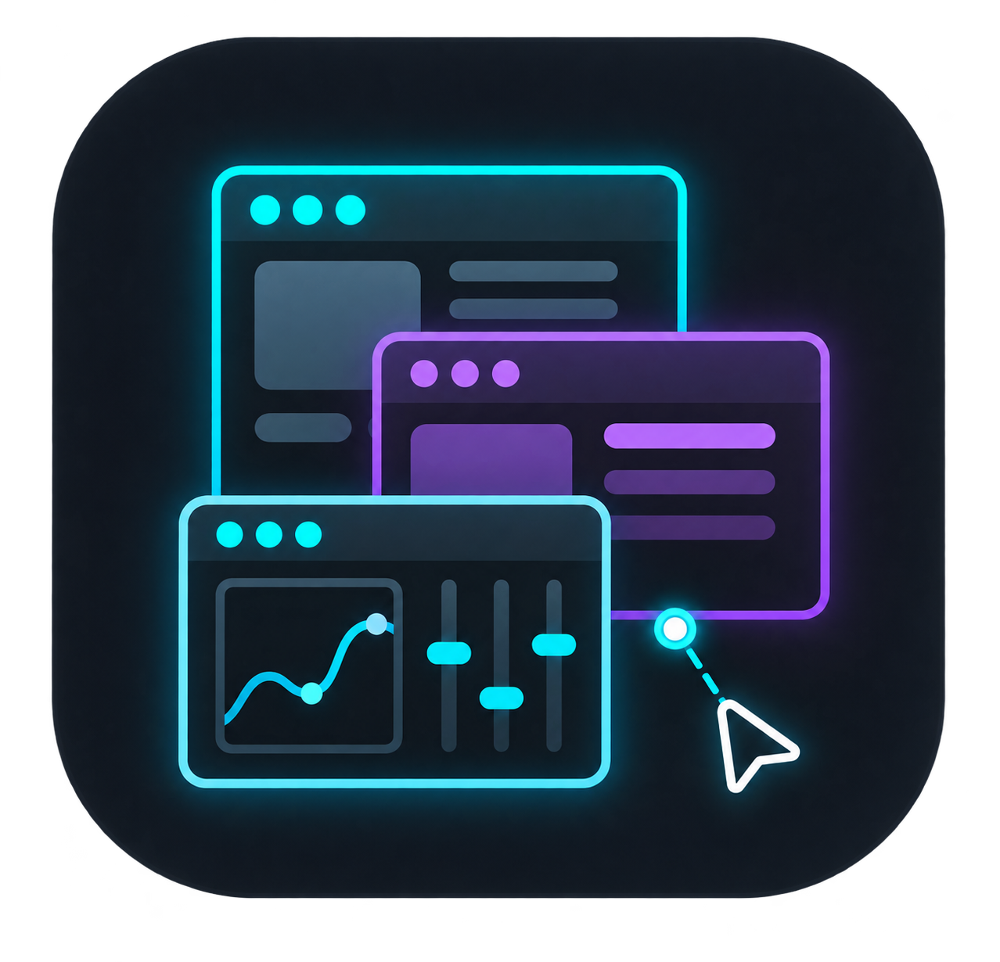

<!--suppress HtmlDeprecatedAttribute, HttpUrlsUsage -->

<div align="center">
  <p>
    
  </p>

  <p>Créez des interfaces utilisateur flottantes avec Dear ImGui</p>

  <p>
    <a href="https://github.com/SuperMonster003/AutoJs6-Plugin-ImGui/releases"></a>
    <a href="https://github.com/SuperMonster003/AutoJs6-Plugin-ImGui/issues"></a>
    <a href="https://github.com/ocornut/imgui"></a>
    <br>
    <a href="https://developer.android.com/studio/archive"></a>
    <a href="https://www.jetbrains.com/idea/download/other.html"></a>
    <a href="https://github.com/SuperMonster003/AutoJs6-Plugin-ImGui/blob/master/LICENSE"></a>
  </p>
</div>

******

### Langues (Languages)

******

Le fichier README.md actuel prend en charge les langues suivantes:

- [简体中文 [zh-Hans]](https://github.com/SuperMonster003/AutoJs6-Plugin-ImGui/blob/master/.readme/README-zh-Hans.md)
- [繁體中文 (香港) [zh-Hant-HK]](https://github.com/SuperMonster003/AutoJs6-Plugin-ImGui/blob/master/.readme/README-zh-Hant-HK.md)
- [繁體中文 (台灣) [zh-Hant-TW]](https://github.com/SuperMonster003/AutoJs6-Plugin-ImGui/blob/master/.readme/README-zh-Hant-TW.md)
- [English [en]](https://github.com/SuperMonster003/AutoJs6-Plugin-ImGui/blob/master/.readme/README-en.md)
- Français [fr] # actuel
- [Español [es]](https://github.com/SuperMonster003/AutoJs6-Plugin-ImGui/blob/master/.readme/README-es.md)
- [日本語 [ja]](https://github.com/SuperMonster003/AutoJs6-Plugin-ImGui/blob/master/.readme/README-ja.md)
- [한국어 [ko]](https://github.com/SuperMonster003/AutoJs6-Plugin-ImGui/blob/master/.readme/README-ko.md)
- [Русский [ru]](https://github.com/SuperMonster003/AutoJs6-Plugin-ImGui/blob/master/.readme/README-ru.md)
- [العربية [ar]](https://github.com/SuperMonster003/AutoJs6-Plugin-ImGui/blob/master/.readme/README-ar.md)

******

### Introduction

******

Le plugin ImGui apporte la bibliothèque d'interface graphique en mode immédiat [Dear ImGui](https://github.com/ocornut/imgui) à AutoJs6 et affiche les contrôles via OpenGL ES dans une fenêtre flottante transparente. Il convient naturellement aux interfaces flottantes légères telles que les panneaux de débogage, les outils de réglage de paramètres et les HUD d'exécution, et réunit la création de fenêtre, la cadence des images, les interactions tactiles et la libération des ressources natives dans une API compacte.

Une fois le plugin activé dans le Centre des plugins, les scripts utilisent directement l'objet global `imgui` (enregistré par AutoJs6, qui charge le plugin au premier appel d'un de ses membres); `plugins.load` n'est pas nécessaire. Nécessite AutoJs6 6.8.0 ou version ultérieure. Lorsque le plugin est plus récent qu'AutoJs6, les membres qu'AutoJs6 ne répertorie pas encore n'apparaissent sur `imgui` qu'après le chargement du plugin (à la première utilisation d'un membre de `imgui`); l'argument `ui` des rappels de rendu est toujours complet.

******

### Fonctionnalités

******

- Sessions adaptatives en superposition ou Activity plein écran avec passage tactile automatique, réduction/déploiement, boutons flottants indépendants, opacité/sécurité, disposition persistante et événements de cycle de vie.
- `launchPrivileged` fournit un mode SurfaceFlinger de production explicite via Shizuku/root géré par AutoJs6; Binder authentifié transmet la Surface privilégiée au moteur complet existant et `/dev/input` fournit l'entrée pointeur observée.
- AutoJs6 enregistre directement le plugin comme objet global `imgui`, si bien qu'aucune étape de chargement n'est nécessaire une fois le plugin activé, comme pour les plugins officiels pinyin / mediainfo.
- Fenêtres flottantes transparentes avec taille, position, fréquence d'image et police configurables; faites glisser une zone vide pour déplacer la fenêtre, utilisez le défilement inertiel à deux doigts et un appui long à un doigt pour le clic droit. Après quelques secondes sans saisie, la fréquence d'image baisse pour économiser la batterie, et le dessin s'interrompt quand l'écran est éteint.
- La famille `inputText` est entièrement reliée à l'IME du système, avec texte de composition, affichage automatique du clavier logiciel et touches d'édition courantes.
- Fenêtres, onglets, nœuds d'arbre, tableaux, popups, menus, infobulles et plus de 60 contrôles en mode immédiat, dont un interrupteur `toggle` de style mobile.
- Système visuel et typographique avec 11 `Themes`, styles groupés, apparences arrondies/bordées/ombrées, pile multi-police, secours CJK et sous-ensemble Material Icons.
- Les textures gérées acceptent chemins de fichiers, octets encodés, `Bitmap` Android et objets `Image` AutoJs6 ; `image` / `imageButton` et trois couches DrawList couvrent l’affichage d’images et le dessin personnalisé.
- `session.capture()` renvoie la fenêtre sous forme d'`Image` AutoJs6; avec `systemCjkFont: true` le système dessine les caractères CJK absents de la police intégrée, avec `pinchZoom: true` deux doigts changent l'échelle de la police, et les fenêtres suivent les changements de densité d'affichage et de taille de police du système.
- Les références légères `imgui.ref(value)` / `{value: x}` fonctionnent avec tous les contrôles avec état, tandis que les assistants historiques à tableaux Java restent entièrement compatibles.
- Les composants de session `logWindow`, `toast` empilés, dialogues Promise, `statsOverlay` à seuils colorés et `dataTable` CRUD sélectionnable fournissent une interface de débogage prête à l'emploi.
- Les API courantes et les énumérations de constantes disposent d'alias PascalCase (p. ex. `ui.Button`) qui conservent le style d'arguments du plugin; la liste des alias et les différences avec les signatures C++ amont figurent dans [ALIASES.md](https://github.com/SuperMonster003/AutoJs6-Plugin-ImGui/blob/master/docs/ALIASES.md).
- L'outillage comprend des déclarations TypeScript complètes, neuf exemples exécutables, des tests Android de rendu, une file d'entrée non bloquante, une mise à jour amont vérifiable et l'automatisation CI des versions.
- Métadonnées du plugin, instructions d'utilisation, README et CHANGELOG localisés dans dix langues.

******

### Installation

******

- Téléchargez depuis [Releases](https://github.com/SuperMonster003/AutoJs6-Plugin-ImGui/releases) l'APK correspondant à l'architecture de votre appareil; en cas de doute, choisissez le paquet `universal`.
- Installez l'APK, ouvrez AutoJs6 et vérifiez sur la page de gestion des plugins que ce plugin est reconnu et activé.
- Appelez directement `imgui.createWindow(...)` dans le script; à la première utilisation, accordez à AutoJs6 l'autorisation de superposition (fenêtre flottante).
- Avant `launchPrivileged`, configurez et autorisez Root ou Shizuku normalement dans AutoJs6. Le plugin réutilise cet état hôte et le mode privilégié ne nécessite pas l'autorisation de superposition.

Prérequis de l'hôte: AutoJs6 avec versionCode 5935 ou ultérieur. Le plugin fournit des binaires `arm64-v8a` / `armeabi-v7a` / `x86_64` / `x86` et requiert Android 7.0 (API 24) ou version ultérieure ainsi qu’un GPU/pilote compatible OpenGL ES 3.0.

******

### Démarrage rapide

******

Une fois le plugin installé et activé, créez des références modifiables et ouvrez une fenêtre flottante:

```js
var enabled = imgui.ref(true);
var volume = imgui.ref(0.5);
var themeColor = imgui.ref([0.25, 0.55, 0.90]);

imgui.createWindow(function (ui, overlay) {
    ui.setNextWindowPos(0, 0, ui.Cond.Always);
    ui.setNextWindowSize(ui.dp(overlay.width), ui.dp(overlay.height), ui.Cond.Always);
    ui.withWindow(
        "ImGui Panel",
        null,
        ui.WindowFlags.NoMove | ui.WindowFlags.NoResize | ui.WindowFlags.NoCollapse,
        function () {
            ui.text("Dear ImGui " + ui.version());
            ui.toggle("Enabled", enabled);
            ui.sliderFloat("Volume", volume, 0, 1, "%.2f");
            ui.colorEdit3("Theme", themeColor);
            if (ui.button("Close", 120, 0)) {
                overlay.close();
            }
        }
    );
}, {
    width: 360,
    height: 240,
    fontSize: 16,
    theme: imgui.Themes.ModernDark,
    appearance: imgui.Appearance.Rounded,
    fps: 60
});
```

Les contrôles modifiables acceptent les références légères créées par `imgui.ref(value)` ou les objets simples `{ value: ... }` ; les anciens assistants `imgui.bool` / `imgui.int` / `imgui.float` / `imgui.string` / `imgui.floats` restent compatibles. La sélection d'un `inputText` ouvre automatiquement l'IME du système avec prise en charge de la composition; passez `ime: false` pour désactiver cette gestion. Les tailles et positions de la fenêtre sont en dp: les options `width`, `height`, `x` et `y`, les champs de la session et les données des événements; `fontSize` est aussi en dp. Les coordonnées dans une frame sont en px; convertissez-les avec `ui.dp()` / `ui.px()`. Les rappels des événements et des boutons s'exécutent sur le thread du script (voir [THREADING.md](https://github.com/SuperMonster003/AutoJs6-Plugin-ImGui/blob/master/docs/THREADING.md)), et [MIGRATION-1.12.md](https://github.com/SuperMonster003/AutoJs6-Plugin-ImGui/blob/master/docs/MIGRATION-1.12.md) liste les changements par rapport aux versions précédentes. Faites glisser une zone vide pour déplacer la fenêtre (`movable: false` la fixe); le balayage vertical à deux doigts possède une inertie configurable (`fling`, `flingFriction`, `flingMinVelocity`, `flingMaxVelocity`) et un appui long à un doigt émet un clic droit (`longPressAsRightClick`, `longPressDuration`, `longPressSlop`). Lorsque la police système ne couvre pas les caractères requis, faites pointer `fontPath` vers un fichier de police TTF ou OTF.

Thèmes et polices : `setTheme` accepte les 11 valeurs de `Themes` et `setStyleProperties` met plusieurs `StyleVar` à jour ; `createWindow` accepte aussi `theme`, `appearance`, `style` et `shadow`. Le tableau `fonts` précharge des polices assets (`asset://...`) ou fichiers pour `pushFont` / `withFont`. Le secours CJK et les icônes sont fusionnés automatiquement ; `Icons` / `icon(name)` fournit les glyphes d’icônes.

Textures et dessin personnalisé : appelez `createTexture` uniquement lorsque la session de fenêtre est prête (normalement lors du premier passage dans son rappel de rendu). L'objet renvoyé expose `width`, `height`, `update(source)` (remplace les pixels et conserve l'identifiant ; `width` / `height` suivent la nouvelle taille) et les méthodes idempotentes `dispose()` / `close()` ; toutes les textures restantes sont libérées automatiquement à la fermeture de la session. `image` / `imageButton` affichent les textures, tandis que `getWindowDrawList`, `getForegroundDrawList` et `getBackgroundDrawList` fournissent les primitives courantes. Les coordonnées DrawList sont exprimées en pixels du Surface. Les valeurs `Image` AutoJs6 de `images.read(...)` ou d'une capture d'écran peuvent être transmises directement, ainsi qu'un `ArrayBuffer` ou un tableau typé contenant des données PNG ou JPEG.

Sessions de fenêtre : les superpositions utilisent `TouchMode.Auto` par défaut, ce qui conserve l’interaction des fenêtres racines ImGui tout en transmettant les zones Surface vides à l’application située dessous ; choisissez `Touchable` ou `Passthrough` pour une politique fixe. Une session peut modifier opacité/sécurité/mode tactile, se réduire en mini-bulle à faible FPS, créer des `addButtonEx` déplaçables, suivre le contenu `AlwaysAutoResize`, mémoriser la disposition avec `iniPath` et publier des événements via `on` / `once` / `off` ou les rappels d’options. `imgui.launch(...)` crée un Surface plein écran dans l’Activity AutoJs6 actuellement reprise et `launchFloaty(...)` sélectionne explicitement une superposition. Chaque moteur de script possède une seule session de rendu native, mais son rappel peut créer autant de racines ImGui `begin` / `withWindow` que nécessaire ; une nouvelle session ferme la précédente. Une exception levée par le rappel de rendu ou par un rappel d'événement est affichée avec sa pile par `console.error` (une seule fois pour une suite de la même erreur) et émise comme événement `error` (`error` / `phase` / `frame`); sans écouteur `error`, une erreur de rendu ferme la session (`closeReason` vaut `render-error`), avec un écouteur le reste de l'image est ignoré et le rendu continue. L'option `debug: true` signale avec `console.warn` et logcat les erreurs d'utilisation comme un `begin` sans `end`, et affiche les fenêtres Metrics et Debug Log. Les méthodes globales comme `setTouchable` / `setGlobalAlpha` / `getComponent` agissent sur la session courante et lèvent `imgui.<name>: no active session` sans session active. Dans une session `imgui.launch`, la touche Retour ferme la session (`closeReason` vaut `back`) sauf si un écouteur `back` appelle `event.preventDefault()`; un clavier virtuel affiché prend d'abord la touche Retour et se masque. Les fenêtres superposées ne reçoivent la touche Retour que lorsque leur saisie de texte a le focus, et elle ne fait alors que masquer le clavier. Avec `debug: true`, un rappel de rendu de plus de 250 ms affiche aussi un `console.warn` qui conseille `threads.start` (au plus une fois toutes les 10 secondes).

Les composants de haut niveau s'attachent à la session active et sont dessinés après le rappel utilisateur : `logWindow` fournit niveaux colorés, effacement, exportation et défilement automatique ; `toast` affiche des notifications temporisées ; `alert` / `confirm` / `singleChoice` / `multiChoice` résolvent des Promises ; `statsOverlay` trace le temps d'image et affiche le temps de travail de chaque image ; et `dataTable` fournit sélection et CRUD. Les dix exemples (`widget-overview`, `parameter-panel`, `log-hud`, `data-table-demo`, `theme-gallery`, `error-handling`, `background-task`, `large-list`, `texture-refresh` et `multi-window`) sont accessibles avec `listExamples` / `getExampleSource` et lancés avec `runExample`. AutoJs6 6.8 ne consomme pas encore les métadonnées génériques d'exemple dans son centre de plugins ; en attendant la prise en charge de l'hôte, exécutez directement l'appel ci-dessous:

```js
imgui.runExample("widget-overview");
```

******

### Aperçu de l'API

******

Les API courantes ont aussi des alias PascalCase (p. ex. `ui.Button` équivaut à `ui.button`). Les alias gardent le style d'arguments du plugin (valeurs modifiables via `imgui.ref`, etc.) et ne correspondent pas un à un aux signatures C++ amont; la liste et les différences figurent dans [ALIASES.md](https://github.com/SuperMonster003/AutoJs6-Plugin-ImGui/blob/master/docs/ALIASES.md). Les méthodes lower camel case correspondent aux opérations Dear ImGui du même nom et se répartissent ainsi:

- Exécution de session : `launch` / `launchFloaty` / `launchPrivileged` / `TouchMode` / `WindowMode`, `setTouchable` / `setMoreTouch` / `setGlobalAlpha` / `setSecure`, `collapseWindow` / `expandWindow`, `addButtonEx`, conversion d'unités `density` / `dp` / `px`, `on` / `once` / `off` avec leurs formes propres à la session, l'événement de session `error` qui signale les erreurs des rappels, l'option `debug` qui active le mode débogage et l'économie d'énergie avec `idleFps` / `idleDelay`, `setFps` / `setIdleFps` / `getFps` et les événements `idle` / `active`.
- Détection du backend: `getBackendCapabilities` / `BackendStatus` indique la disponibilité et l'aptitude à la production des fenêtres, du toucher réparti, du processus privilégié, de la saisie directe, de Docking et de Multi-Viewport, sans élever les privilèges.
- Session et fenêtres: `createWindow` / `closeWindow` / `withWindow` / `withChild` / `setNextWindowPos` / `setNextWindowSize` / `setNextWindowBgAlpha` / `setNextWindowFocus` / `setNextWindowCollapsed`, ainsi que des requêtes d'état de fenêtre comme `isWindowHovered`.
- Texte et contrôles: `text` / `textColored` / `textWrapped` / `separatorText` / `bulletText` / `labelText` / `button` / `arrowButton` / `invisibleButton` / `checkbox` / `toggle` / `radioButton` / `sliderFloat` / `sliderInt` / `vSliderFloat` / `dragFloat` / `dragInt` / `inputText` / `inputInt` / `inputFloat` / `inputTextMultiline` / `colorEdit3` / `colorEdit4` / `colorPicker4` / `colorButton` / `progressBar` / `plotLines` / `plotHistogram`, entre autres. Contrôles de 2 à 4 valeurs: `dragFloat2/3/4` / `dragInt2/3/4` / `sliderFloat2/3/4` / `sliderInt2/3/4` / `inputFloat2/3/4` / `inputInt2/3/4` / `dragFloatRange2` / `dragIntRange2` / `sliderAngle`.
- Conteneurs et navigation: `withTabBar` / `withTabItem` / `withTreeNode` / `treeNodeEx` / `collapsingHeader` / la famille de tableaux `withTable` / `withListBox` / `withCombo` / `selectable`, ainsi que `listClipper` pour les longues listes. Tri des tableaux: `tableGetSortSpecs` / `SortDirection` et `dataTable` avec `sortable: true`. Sélection multiple: `beginMultiSelect` / `endMultiSelect` / `setNextItemSelectionUserData` / `isItemToggledSelection` avec `MultiSelectFlags`, et `selectionStorage` pour conserver la sélection.
- Popups et menus: `openPopup` / `withPopup` / `withPopupModal` / `beginPopupContextItem` / `beginPopupContextWindow` / `withContextItem` / `withContextWindow` / `closeCurrentPopup` / `withMenuBar` / `withMenu` / `menuItem` / `setTooltip` / `setItemTooltip` / `withItemTooltip`.
- Style et mise en page: `styleColorsDark` / `styleColorsLight` / `styleColorsClassic` / `pushStyleColor` / `pushStyleVar` / `setWindowFontScale` / `withGroup` / `withDisabled` / `withId` / `indent` / `sameLine` / `separator` / `spacing`, ainsi que les familles de curseur et de défilement.
- Textures et dessin : `createTexture` / `texture.update` / `destroyTexture` / `image` / `imageButton` / `colorU32`, ainsi que `getWindowDrawList` / `getForegroundDrawList` / `getBackgroundDrawList` avec des primitives de ligne, rectangle, cercle, triangle, texte, polyligne, Bézier et image. Tracés : `pathLineTo` / `pathArcTo` / `pathArcToFast` / `pathBezierCubicCurveTo` / `pathBezierQuadraticCurveTo` / `pathRect` / `pathStroke` / `pathFillConvex` / `pathFillConcave` ; `pushClipRect` / `popClipRect` sur les listes de dessin et les fenêtres ; autres formes : `addEllipse` / `addNgon` / `addQuad` / `addBezierQuadratic` / `addRectFilledMultiColor` / `addConvexPolyFilled` / `addConcavePolyFilled` / `addImageQuad` / `addImageRounded`.
- Requêtes et entrée: requêtes d'état telles que `isItemClicked` / `isItemHovered` / `isItemActive` / `isItemEdited` / `isMouseDown` / `getMousePos` / `calcTextSize` / `framerate`, focus actif via `setKeyboardFocusHere`, et primitives `addInputCharacters` / `sendKey` / `addMouseWheel` / `wantTextInput`. Toutes les valeurs `InputTextFlags` actuellement exposées sont transmises à Dear ImGui; les drapeaux dépendant de callbacks sont omis et `WordWrap` ne s'applique qu'à l'entrée multiligne. Requêtes de touches et raccourcis : `isKeyDown` / `isKeyPressed` / `isKeyReleased` / `getKeyPressedAmount` / `getKeyName` / `isKeyChordPressed` / `shortcut` / `setNextItemShortcut`, avec des combinaisons comme `ui.Mod.Ctrl | ui.Key.S`. Presse-papiers : `getClipboardText` / `setClipboardText`. Injection de pointeur pour tester automatiquement l'interface : `addMousePosEvent` / `addMouseButtonEvent` (pixels de la trame, comme `getMousePos`).
- Glisser-déposer : `withDragDropSource` / `withDragDropTarget`, `beginDragDropSource` / `setDragDropPayload` / `endDragDropSource` / `beginDragDropTarget` / `acceptDragDropPayload` / `endDragDropTarget` / `getDragDropPayload`, avec `DragDropFlags` ; la charge utile est une chaîne, un nombre ou tout objet sérialisable en JSON.
- Outils de débogage: `showMetricsWindow` / `showDebugLogWindow` / `showIdStackToolWindow` / `showStyleEditor` / `showAboutWindow` / `showUserGuide` affichent les fenêtres d'outils intégrées de Dear ImGui; chacune accepte une référence booléenne mutable facultative que le bouton de fermeture met à false.
- Composants de haut niveau et exemples : `logWindow` / `toast` / `alert` / `confirm` / `singleChoice` / `multiChoice` / `statsOverlay` / `dataTable`, plus `listExamples` / `getExampleSource` / `runExample` ; chaque session propose les mêmes fabriques.
- Références modifiables : `imgui.ref` léger (ou un objet `{value: x}`), plus les assistants compatibles à tableaux Java `imgui.bool` / `imgui.int` / `imgui.float` / `imgui.string` / `imgui.floats` / `imgui.ints` / `imgui.strings`.
- Constantes: `BackendStatus` / `Cond` / `WindowFlags` / `ChildFlags` / `InputTextFlags` / `SliderFlags` / `TreeNodeFlags` / `SelectableFlags` / `TabBarFlags` / `TabItemFlags` / `ComboFlags` / `PopupFlags` / `HoveredFlags` / `FocusedFlags` / `ColorEditFlags` / `TableFlags` / `TableColumnFlags` / `TableRowFlags` / `TableBgTarget` / `SortDirection` / `Col` / `StyleVar` / `Themes` / `Appearance` / `Fonts` / `Icons` / `Dir` / `Key` / `Mod` / `InputFlags` / `DragDropFlags` / `MultiSelectFlags` / `MouseButton` / `ButtonFlags` / `TextureFlags` / `DrawListLayer` / `DrawFlags` / `LogLevel` / `ToastPosition` / `Limits`, correspondant aux énumérations Dear ImGui ou tables du plugin du même nom.

******

### Limitations connues

******

- Une seule session ImGui, donc une seule Surface, peut exister à la fois: une nouvelle session superposée ou Activity ferme la précédente, et une session créée par un autre script la remplace aussi. "Plusieurs fenêtres" désigne plusieurs fenêtres racines ImGui dans cette session, pas plusieurs fenêtres flottantes; voir `docs/MULTI-WINDOW.md`.
- `imgui.launch` nécessite une Activity AutoJs6 actuellement à l’état resumed ; utilisez `launchFloaty` lorsque le script doit continuer sans Activity hôte au premier plan.
- Le mode privilégié est fixe en plein écran et limité au pointeur: les champs de texte utilisent une zone de saisie temporaire d'AutoJs6, qui demande l'autorisation de superposition et ajoute le texte au curseur seulement; pas de clavier, d'alpha/sécurité du calque hôte, de réduction, de boutons Android annexes ni de reconstruction dynamique après rotation. L'entrée directe n'utilise pas `EVIOCGRAB` et les politiques OEM SurfaceControl/SELinux peuvent encore refuser le démarrage; la sonde n'exécute pas `su` et ne demande pas Shizuku.

******

### Historique des versions

******

#### v1.18.1

###### 2026/11/02

* `Correctif` session.on: un écouteur ready ajouté après le retour de createWindow n'était jamais appelé, car la fenêtre est en général prête avant. Il reçoit maintenant l'événement une fois
* `Correctif` session.once: l'écouteur ne recevait pas la session comme deuxième argument. Il reçoit maintenant (event, session), comme avec session.on

#### v1.18.0

###### 2026/11/01

* `Fonctionnalité` setNextWindowFocus() et setNextWindowCollapsed(collapsed, condition) permettent à un script de donner le focus à une fenêtre de la session ou de la replier, pour le prochain begin ou withWindow. L'exemple multi-window a un bouton pour chacune
* `Correctif` dataTable: la fonction render d'une colonne était documentée mais jamais appelée. Elle dessine maintenant les cellules de cette colonne
* `Correctif` launchPrivileged: à partir d'Android 12, les touchers sur la zone de texte temporaire et le clavier n'arrivaient pas, et un toucher à l'extérieur ne fermait pas la zone. La couche est maintenant masquée tant que la zone est ouverte
* `Amélioration` imgui.d.ts décrit l'API avec précision: chaque membre a un commentaire avec ses unités et son thread, alert / confirm / singleChoice / multiChoice ont de vraies signatures, chaque événement de session a ses propres champs, et un nom d'option mal orthographié est une erreur en TypeScript. Les options title et background de toast, qui n'ont jamais rien fait, ont été retirées. Tous les exemples fournis passent tsc --strict

#### v1.17.0

###### 2026/11/01

* `Fonctionnalité` Listes à sélection multiple: beginMultiSelect / endMultiSelect / setNextItemSelectionUserData / isItemToggledSelection sélectionnent plusieurs lignes avec un appui, Ctrl+appui, Shift+appui, Ctrl+A et Échap (MultiSelectFlags règle les options). imgui.selectionStorage() conserve les lignes sélectionnées pour vous. Cela fonctionne avec listClipper: une plage avec Shift peut couvrir 100000 lignes, même des lignes jamais dessinées. Un téléphone n'a pas de touches Ctrl ni Shift, c'est pourquoi l'exemple large-list affiche deux cases qui les maintiennent; docs/LIMITS.md explique le reste.
* `Fonctionnalité` Nouvel exemple multi-window et nouveau guide docs/MULTI-WINDOW.md: plusieurs panneaux dans une session, chacun avec sa position, sa flèche de repli et son bouton de fermeture, et la fenêtre touchée passe au premier plan. Une seule session (une Surface) peut exister à la fois, donc "plusieurs fenêtres" désigne toujours des fenêtres dans une session, pas plusieurs fenêtres flottantes.
* `Correctif` Fenêtres flottantes en mode TouchMode.Auto par défaut: un appui arrivait une hauteur de barre d'état plus bas que le doigt, si bien que les commandes proches du haut d'une fenêtre pouvaient ne pas réagir et que les barres de titre ne se déplaçaient pas

##### Pour consulter davantage de versions

* [CHANGELOG.md](https://github.com/SuperMonster003/AutoJs6-Plugin-ImGui/blob/master/app/src/main/assets/doc/CHANGELOG-fr.md)

******

### Compilation

******

```powershell
.\gradlew.bat :app:assembleDebug
```

Compilation Release avec noms de fichiers contenant le condensé CRC32:

```powershell
.\gradlew.bat :app:appendDigestToReleasedFiles
```

Vérification de l'inventaire des sources natives, de la parité des déclarations JNI, des tests unitaires et de l'intégrité de la répartition par ABI:

```powershell
.\gradlew.bat :app:verifyImGuiDebugApks
```

Les paramètres de compilation proviennent de `version.properties`; le SDK minimal actuel est 24 et le SDK cible est 37.

******

### Structure du projet

******

```text
.readme/lang_*.json
.changelog/lang_*.json
.python/generate_markdown.py
app/src/main/assets/plugin/index.js
app/src/main/assets/examples/widget-overview.js
app/src/main/cpp/ImGuiBridge.cpp
app/src/main/res/values-*/strings.xml
app/src/main/res/raw-*/plugin_instruction.md
Roadmap.md
```

`index.js` est le module `imgui` côté moteur de script et `ImGuiBridge.cpp` est le pont JNI vers Dear ImGui. `strings.xml` contient les descriptions localisées du plugin et `plugin_instruction.md` contient les instructions d'utilisation affichées par l'hôte. Les fichiers README et CHANGELOG sont générés à partir des sources JSON par `.python/generate_markdown.py`; modifiez les sources JSON plutôt que les fichiers générés.

******

### Liens

******

- Projet AutoJs6: https://github.com/SuperMonster003/AutoJs6
- Projet officiel Dear ImGui: https://github.com/ocornut/imgui
- Index de la documentation: https://github.com/SuperMonster003/AutoJs6-Plugin-ImGui/blob/master/docs/README.md
- Feuille de route des fonctionnalités: https://github.com/SuperMonster003/AutoJs6-Plugin-ImGui/blob/master/Roadmap.md


[16 KB page alignment and build verification](https://github.com/SuperMonster003/AutoJs6-Plugin-ImGui/blob/master/docs/16kb.md)
